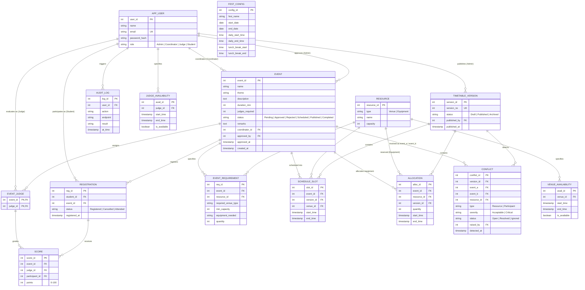

# Engine 3 – Event Transaction & Data Management

**College Event Proposal, Approval and Timetable Generation System**  
*Technology Stack: Node.js (v20+), Express.js, PostgreSQL (v15+), node-postgres (`pg`), `dotenv`*

---

## 1. System Overview & Engine Scope

Engine 3 serves as the **authoritative database and transaction management engine** for the campus fest management system. It provides persistence guarantees, ACID transactional workflows, PostgreSQL constraint enforcement (including physical venue and equipment exclusion constraints), relational mapping, and timetable version lifecycle controls.

### Architectural Boundary
- **Engine 3 owns**: Relational data modeling, schema definition, DDL/DML migrations, transaction boundaries (`BEGIN` / `COMMIT` / `ROLLBACK`), PostgreSQL GiST double-booking prevention, timetable versioning (Draft → Published → Archived), conflict persistence, and reporting views.
- **Engine 3 does NOT own**:
  - Timetable scheduling algorithms / constraint satisfaction solvers (*Engine 1*).
  - Resource optimization heuristics (*Engine 2*).
  - User authentication, JWT issuance, password hashing, and frontend UI (*Engine 4*).

---

## 2. Entity-Relationship (ER) Architecture

The database architecture consists of **15 relational tables**:
- **11 Core Entities & Associative Relations**: `app_user`, `event`, `resource`, `timetable_version`, `schedule_slot`, `allocation`, `event_judge`, `registration`, `score`, `conflict`, `audit_log`.
- **4 Supporting / Solver Input Tables**: `fest_config`, `event_requirement`, `venue_availability`, `judge_availability`.



---

## 3. ER-to-Relational Mapping Verification

The relational schema implements standard ER-to-relational mapping principles:

1. **Strong Entities**:
   - `APP_USER`, `RESOURCE`, `TIMETABLE_VERSION`, and `FEST_CONFIG` map directly to relational tables with surrogate integer primary keys (`SERIAL PRIMARY KEY`).
   - Alternate candidate keys are enforced with `UNIQUE` constraints (e.g. `app_user.email`, `timetable_version.version_no`).

2. **Weak / Dependent Entities**:
   - `EVENT_REQUIREMENT` is dependent on `EVENT` (`ON DELETE CASCADE`).
   - `VENUE_AVAILABILITY` is dependent on `RESOURCE` (`ON DELETE CASCADE`).
   - `JUDGE_AVAILABILITY` is dependent on `APP_USER` (`ON DELETE CASCADE`).

3. **1:M (One-to-Many) Relationships**:
   - Represented via foreign keys stored in the "Many" side relation:
     - `EVENT.coordinator_id` $\to$ `APP_USER.user_id`
     - `EVENT.approved_by` $\to$ `APP_USER.user_id` (nullable, populated on approval)
     - `TIMETABLE_VERSION.published_by` $\to$ `APP_USER.user_id` (nullable, populated on publish)
     - `AUDIT_LOG.user_id` $\to$ `APP_USER.user_id` (nullable for system actions)

4. **M:N (Many-to-Many) Relationships & Associative Tables**:
   - **Judges to Events**: Resolved by `EVENT_JUDGE` with composite primary key `(event_id, judge_id)`.
   - **Students to Events**: Resolved by `REGISTRATION` with surrogate PK `reg_id` and unique composite key `(event_id, student_id)`.
   - **Events to Venues across Time**: Resolved by `SCHEDULE_SLOT` with unique composite key `(version_id, event_id)` and GiST exclusion constraint on `(version_id, venue_id, tsrange)`.
   - **Events to Equipment across Time**: Resolved by `ALLOCATION` with GiST exclusion constraint on `(version_id, resource_id, tsrange)`.
   - **Event Clash Pairs**: Resolved by `CONFLICT` with canonical ordering `CHECK (event_a < event_b)` and `UNIQUE NULLS NOT DISTINCT (version_id, event_a, event_b, type, resource_id)`.

5. **Ternary Relationship (`SCORE`)**:
   - Associates an `EVENT`, a Judge (`APP_USER`), and a Participant (`APP_USER`).
   - Referential integrity is enforced via composite foreign keys:
     - `FOREIGN KEY (event_id, judge_id) REFERENCES event_judge(event_id, judge_id) ON DELETE CASCADE`
     - `FOREIGN KEY (event_id, participant_id) REFERENCES registration(event_id, student_id) ON DELETE CASCADE`
   - Uniqueness: `UNIQUE (event_id, judge_id, participant_id)`
   - Business integrity: `CHECK (judge_id <> participant_id)` prevents self-judging.

---

## 4. Normalization Verification Report (1NF, 2NF, 3NF / BCNF)

Every relation in Engine 3 was systematically audited to verify compliance with First, Second, and Third Normal Forms.

### Summary Criteria
- **1NF**: Atomic attributes, no repeating groups or nested arrays, primary key defined on every table.
- **2NF**: In 1NF and no non-prime attribute is partially dependent on any candidate key.
- **3NF**: In 2NF and no non-prime attribute is transitively dependent on any candidate key ($X \to Y \implies X$ is a superkey or $Y$ is prime).

| Table | Candidate Keys | Functional Dependencies (FDs) | Normal Form | Justification |
|---|---|---|---|---|
| `app_user` | `user_id`, `email` | `user_id` $\to$ `name, email, password_hash, role`<br>`email` $\to$ `user_id, name, password_hash, role` | **3NF / BCNF** | All determinants are candidate keys. No transitive dependencies. |
| `fest_config` | `config_id` | `config_id` $\to$ `fest_name, start_date, end_date, daily_start_time, daily_end_time, lunch_break_start, lunch_break_end` | **3NF / BCNF** | Single primary key determines all configuration attributes. |
| `resource` | `resource_id` | `resource_id` $\to$ `type, name, capacity` | **3NF / BCNF** | Single attribute PK. No transitive dependencies. |
| `venue_availability` | `avail_id` | `avail_id` $\to$ `venue_id, start_time, end_time, is_available` | **3NF / BCNF** | Single attribute PK. FK `venue_id` references `resource`. |
| `judge_availability` | `avail_id` | `avail_id` $\to$ `judge_id, start_time, end_time, is_available` | **3NF / BCNF** | Single attribute PK. FK `judge_id` references `app_user`. |
| `event` | `event_id` | `event_id` $\to$ `name, theme, description, duration_min, judges_required, status, remarks, coordinator_id, approved_by, approved_at, created_at` | **3NF / BCNF** | All non-prime attributes functionally depend solely on `event_id`. |
| `event_requirement` | `req_id` | `req_id` $\to$ `event_id, resource_id, required_venue_type, min_capacity, equipment_needed, quantity` | **3NF / BCNF** | Single surrogate PK. No partial or transitive dependencies. |
| `event_judge` | `(event_id, judge_id)` | `(event_id, judge_id)` $\to$ $\emptyset$ | **3NF / BCNF** | Pure associative entity with no non-prime attributes. |
| `timetable_version` | `version_id`, `version_no` | `version_id` $\to$ `version_no, status, published_by, published_at`<br>`version_no` $\to$ `version_id, status, published_by, published_at` | **3NF / BCNF** | Both candidate keys are minimal superkeys. |
| `schedule_slot` | `slot_id`, `(version_id, event_id)` | `slot_id` $\to$ `event_id, version_id, venue_id, start_time, end_time`<br>`(version_id, event_id)` $\to$ `slot_id, venue_id, start_time, end_time` | **3NF / BCNF** | All non-prime attributes depend on full candidate keys. Venue details remain normalized in `resource`. |
| `allocation` | `alloc_id` | `alloc_id` $\to$ `event_id, resource_id, version_id, quantity, start_time, end_time` | **3NF / BCNF** | Version-specific equipment reservation. Determinant is candidate key. |
| `conflict` | `conflict_id` | `conflict_id` $\to$ `version_id, event_a, event_b, resource_id, type, severity, status, raised_by, detected_at` | **3NF / BCNF** | Single surrogate key. Event pair is canonicalized (`event_a < event_b`). |
| `registration` | `reg_id`, `(event_id, student_id)` | `reg_id` $\to$ `student_id, event_id, status, registered_at`<br>`(event_id, student_id)` $\to$ `reg_id, status, registered_at` | **3NF / BCNF** | Both candidate keys determine `status` and timestamp. No partial dependency. |
| `score` | `score_id`, `(event_id, judge_id, participant_id)` | `score_id` $\to$ `event_id, judge_id, participant_id, points`<br>`(event_id, judge_id, participant_id)` $\to$ `score_id, points` | **3NF / BCNF** | `points` depends on the full ternary candidate key. |
| `audit_log` | `log_id` | `log_id` $\to$ `user_id, action, endpoint, result, at_time` | **3NF / BCNF** | Append-only transaction log. All attributes depend strictly on `log_id`. |

---

## 5. Constraints, Triggers & Performance Indexes

### A. Database-Level Double-Booking Prevention
Using PostgreSQL's `btree_gist` extension, temporal exclusion constraints are enforced directly in the database engine:
- **Venue Exclusivity**:
  ```sql
  EXCLUDE USING gist (
      version_id WITH =,
      venue_id   WITH =,
      tsrange(start_time, end_time) WITH &&
  )
  ```
  *Back-to-back bookings (e.g. 10:00–11:00 and 11:00–12:00) are permitted because ranges are half-open $[start, end)$.*
- **Equipment Exclusivity**:
  ```sql
  EXCLUDE USING gist (
      version_id  WITH =,
      resource_id WITH =,
      tsrange(start_time, end_time) WITH &&
  )
  ```

### B. Single Published Version Rule
A conditional unique index guarantees that at most **one** timetable version can hold the `'Published'` state across the entire database:
```sql
CREATE UNIQUE INDEX one_published_version
    ON timetable_version ((1))
    WHERE status = 'Published';
```

### C. Procedural PL/pgSQL Triggers
1. `trg_slot_venue_type`: Asserts `schedule_slot.venue_id` references a resource of `type = 'Venue'` (rejects equipment).
2. `trg_slot_duration`: Enforces `(end_time - start_time) = event.duration_min * INTERVAL '1 minute'`.
3. `trg_event_roles`: Ensures `coordinator_id` has role `'Coordinator'` and `approved_by` has role `'Admin'`.
4. `trg_event_judge_role` & `trg_judge_avail_role`: Ensures assigned judges have role `'Judge'`.
5. `trg_registration_student_role`: Ensures registered participants have role `'Student'`.

### D. Relational Clash Views
- `v_judge_conflicts`: Detects judges double-booked across concurrent slots within the same timetable version.
- `v_participant_conflicts`: Detects students registered for concurrent slots within the same timetable version.
- `v_event_judge_shortfall`: Flags events where `COUNT(assigned_judges) < judges_required`.
- `v_capacity_violations`: Flags schedule slots where `registered_students > venue.capacity`.

---

## 6. Project Layout & Directory Structure

```text
e3/
├── database/
│   ├── schema.sql            # 15 tables, 4 views, 5 triggers, GiST constraints
│   ├── schema_reset.sql      # Teardown script for clean re-installs
│   ├── sample_data.sql       # Comprehensive seed data with clash scenarios
│   └── tests.sql             # 16 native PostgreSQL automated regression tests
├── src/
│   ├── config/
│   │   └── db.js             # pg.Pool configuration, string time parsers, test guard
│   ├── controllers/
│   │   └── eventController.js# Express controllers for HTTP API
│   ├── repositories/
│   │   └── repositories.js   # Parameterized SQL data access layer
│   ├── routes/
│   │   └── eventRoutes.js    # REST route endpoints (mounted at /api)
│   ├── services/
│   │   ├── timetableService.js  # Conflict detection, publish transactions, schedule saving
│   │   └── transactionService.js# withTransaction ACID wrapper, error mapping
│   └── app.js                # Express application with health probes
├── scripts/
│   ├── setupDb.js            # DB initialization runner (npm run db:setup / db:reset)
│   ├── testConnection.js     # DB diagnostic probe (npm run db:check)
│   ├── runSqlTests.js        # Test runner for database/tests.sql
│   └── lib.js                # Shared file execution helpers
├── tests/
│   ├── connection.test.js    # Connection, tables, views, pool load, type parsing tests
│   ├── transaction.test.js   # CRUD, ACID commit/rollback, FK/role/CHECK rejection tests
│   ├── booking.test.js       # GiST exclusions, duration triggers, concurrent booking tests
│   ├── publishing.test.js    # Publishing lifecycle, conflict blocking, advisory locks tests
│   ├── api.test.js           # REST API endpoints & Express integration tests
│   └── helpers.js            # Shared test runner setup & fixtures
├── legacy_python/            # Archived Python files
├── .env.example              # Environment variables template
├── .gitignore                # Protects .env and node_modules from Git
├── package.json              # ES Modules / Node test runner scripts
└── README.md                 # Complete system documentation & normalization report
```

---

## 7. Setup & Execution Instructions (Windows)

### Prerequisites
- Node.js 20.10+ (Node 22 LTS recommended)
- PostgreSQL 15+ running on `localhost:5432` with `btree_gist` extension available.

### Step-by-Step Setup
1. **Install Dependencies**:
   ```powershell
   npm install
   ```

2. **Configure Environment**:
   ```powershell
   copy .env.example .env
   ```
   *Edit `.env` to supply your local PostgreSQL password (`DB_PASSWORD`). The default database name is `campus_sync`.*

3. **Initialize Database & Seed Data**:
   ```powershell
   npm run db:reset
   ```
   *Creates the `campus_sync` database, executes `schema.sql`, and populates sample data.*

4. **Verify Database Integrity**:
   ```powershell
   npm run db:check
   ```
   *Checks connectivity, verifies all 15 tables and 4 views exist, and displays row counts.*

5. **Run Native PostgreSQL SQL Test Suite**:
   ```powershell
   npm run test:sql
   ```
   *Executes all 16 SQL assertion tests in `database/tests.sql` against `campus_sync_test`.*

6. **Run Full Node.js Integration & Concurrency Test Suite**:
   ```powershell
   npm test
   ```
   *Executes 92 automated tests across 10 suites covering transactions, concurrency, exclusion constraints, conflict detection, and REST APIs.*

7. **Start the API Server**:
   ```powershell
   npm start
   ```
   *The server starts on `http://localhost:3000/api` with health checks available at `/health` and `/health/db`.*

---

## 8. REST API Reference

| Endpoint | Method | Description |
|---|---|---|
| `/health` | `GET` | Health status probe (`{ status: 'ok', database: true }`) |
| `/health/db` | `GET` | Database connectivity probe (`{ status: 'healthy', database: 'connected' }`) |
| `/api/events/approved` | `GET` | Approved event proposals with requirements and assigned judges for Engine 1 |
| `/api/venues` | `GET` | List of all venue resources with seating capacities |
| `/api/events` | `POST` | Create a new event proposal |
| `/api/events/:id` | `GET` | Fetch detailed event information |
| `/api/events/:id/status` | `PATCH` | Update proposal status (`Pending` $\to$ `Approved` / `Rejected`) |
| `/api/events/:id/register` | `POST` | Register a student participant for an event |
| `/api/events/:id/scores` | `POST` | Submit an evaluation score by an assigned judge |
| `/api/versions` | `POST` | Initialize a new `Draft` timetable version |
| `/api/versions/:id/schedule` | `GET` | Retrieve scheduled timetable slots for a version |
| `/api/versions/:id/schedule` | `PUT` | Atomically save or replace schedule slots for a version |
| `/api/versions/:id/conflicts/detect` | `POST` | Run idempotent conflict detection and populate `conflict` table |
| `/api/versions/:id/publish` | `POST` | Validate, resolve conflicts, and publish timetable version |
