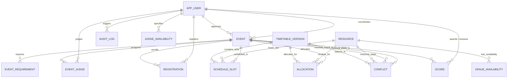

# Engine 3: Database Engine (PostgreSQL + Python + psycopg2)

College Fest Event Management, Proposal Approval, and Timetable Generation System.  
Engine 3 owns the relational data model, persistence layer, transactional safety, and automated conflict detection.

---

## Final Folder Structure

```
e3/
├── db/
│   ├── __init__.py           # Re-exports connection helpers, exceptions, and repository methods
│   ├── connection.py         # SimpleConnectionPool, context manager, RealDictCursor, error mapping
│   ├── exceptions.py         # Custom domain exceptions (ConflictError, ValidationError, NotFoundError)
│   └── repositories.py       # Data Access Layer (DAL) queries used by scheduler, API, and reports
├── tests/
│   ├── __init__.py
│   └── test_engine.py        # Pytest integration test suite
├── .env.example              # Template for database credentials
├── .gitignore                # Protects .env, venv/, and caches from Git
├── db.py                     # Backward-compatibility shim
├── README.md                 # Complete documentation, ER diagram, and interface contract
├── requirements.txt          # Python dependencies (psycopg2-binary, python-dotenv, pytest)
├── sample_data.sql           # Realistic seed data with clean schedules and deliberate test clashes
├── schema.sql                # Production DDL (CREATE IF NOT EXISTS, triggers, views, indexes)
├── schema_reset.sql          # Safe teardown script invoked only by setup_db.py --reset
├── setup_db.py               # Automated database creator and migration runner
├── test_connection.py        # Diagnostic script validating tables, views, and row counts
└── tests.sql                 # Plain-SQL automated test suite (16 test cases reporting PASS/FAIL)
```

---

## Entity-Relationship (ER) Diagram



---

## Database Tables (15 Tables)

1. `app_user`: System user accounts with roles (`Admin`, `Coordinator`, `Judge`, `Student`) and hashed credentials.
2. `fest_config`: Master festival schedule boundaries (start/end dates, daily start/end times, lunch break window).
3. `resource`: Physical venues and shared equipment along with seating capacity and type (`Venue`, `Equipment`).
4. `venue_availability`: Time windows during which individual venues are open and operational for fest activities.
5. `judge_availability`: Available time windows submitted by judges for event assignments.
6. `event`: Event proposals, status lifecycle (`Pending`, `Approved`, `Scheduled`, `Published`, `Rejected`), and duration.
7. `event_requirement`: Scheduler requirements for an event (venue type, minimum capacity, equipment, quantities).
8. `event_judge`: Junction assigning qualified judges (`Judge` role) to evaluate specific events.
9. `timetable_version`: Timetable versioning supporting drafts, archives, and published states.
10. `schedule_slot`: Event assignments to venue time slots per version; prevents overlapping venue bookings.
11. `allocation`: Version-aware equipment bookings; prevents concurrent double-booking of physical resources.
12. `conflict`: Records detected schedule or resource conflicts with severity (`Critical`, `Acceptable`) and status.
13. `registration`: Student enrollments for events, enforcing one active enrollment per student per event.
14. `score`: Grades awarded by judges to participants (0–100), barring self-scoring and duplicate scores.
15. `audit_log`: Immutable audit log recording user actions, API endpoints, results, and timestamps.

---

## Conflict Detection & Reporting Views

- `v_judge_conflicts`: Identifies judges assigned to concurrent overlapping slots within the same timetable version.
- `v_participant_conflicts`: Identifies students registered for concurrent overlapping slots within the same timetable version.
- `v_event_judge_shortfall`: Flags events where assigned judges are fewer than `event.judges_required`.
- `v_capacity_violations`: Flags scheduled events where active registrations exceed venue capacity.

---

## Key Constraints & Business Rules

1. **No Overlapping Bookings**:
   - `schedule_slot` enforces venue exclusivity per version via PostgreSQL GiST exclusion:
     `EXCLUDE USING gist (version_id WITH =, venue_id WITH =, tsrange(start_time, end_time) WITH &&)`.
   - `allocation` enforces single-booking of equipment items via GiST exclusion.
   - Half-open intervals `[start, end)` permit back-to-back slots (e.g. 10:00–11:00 and 11:00–12:00 in the same venue).
2. **Single Published Version**:
   - Unique partial index `one_published_version` guarantees at most one version has `status = 'Published'`.
3. **Reserved Keyword Protection**:
   - The user table is named `app_user` because `user` is reserved in PostgreSQL.
4. **Role Enforcement**:
   - Automated triggers ensure `coordinator_id` has role `Coordinator`, `approved_by` has role `Admin`, `judge_id` has role `Judge`, and `student_id` has role `Student`.
5. **Slot Duration Invariant**:
   - Trigger `trg_slot_duration` ensures slot duration `(end_time - start_time)` exactly equals `event.duration_min`.

---

## Interface Contract (Scheduler & Solvers)

### 1. JSON Provided to Scheduler (`get_approved_events()`, `get_venues()`)

```json
{
  "events": [
    {
      "event_id": 1,
      "name": "Hackathon 2026",
      "theme": "Innovation",
      "duration_min": 120,
      "judges_required": 2,
      "status": "Approved",
      "coordinator_id": 2,
      "coordinator_name": "Rahul Coordinator",
      "coordinator_email": "rahul.c@college.edu",
      "assigned_judges": [
        {"judge_id": 4, "name": "Dr. Kulkarni", "email": "kulkarni.j@college.edu"},
        {"judge_id": 5, "name": "Prof. Deshpande", "email": "deshpande.j@college.edu"}
      ],
      "requirements": [
        {
          "req_id": 1,
          "required_venue_type": "Venue",
          "min_capacity": 50,
          "equipment_needed": "Projector 1",
          "quantity": 1
        }
      ],
      "registered_count": 3
    }
  ],
  "venues": [
    {"resource_id": 1, "name": "Main Auditorium", "capacity": 500, "type": "Venue"},
    {"resource_id": 2, "name": "Seminar Hall", "capacity": 120, "type": "Venue"},
    {"resource_id": 3, "name": "Computer Lab 1", "capacity": 60, "type": "Venue"}
  ]
}
```

### 2. JSON Returned by Scheduler to Save Schedule (`save_schedule(version_id, slots)`)

```json
[
  {
    "event_id": 1,
    "venue_id": 3,
    "start_time": "2026-12-05 09:00:00",
    "end_time": "2026-12-05 11:00:00"
  },
  {
    "event_id": 2,
    "venue_id": 2,
    "start_time": "2026-12-05 11:00:00",
    "end_time": "2026-12-05 12:30:00"
  }
]
```

---

## Python Data Access Layer (db/ Package)

| Function | Purpose |
|---|---|
| `get_db_connection()` | Context manager providing pooled connection with automatic commit/rollback |
| `get_approved_events()` | Returns events ready to be scheduled, including requirements and judges |
| `get_venues()` | Returns all resources with `type = 'Venue'` |
| `create_version(version_no, status)` | Creates a new draft timetable version |
| `save_schedule(version_id, slots)` | Atomically replaces slots for a version using `execute_values` |
| `publish_version(version_id)` | Archives active published versions and publishes new version in one transaction |
| `detect_conflicts(version_id)` | Scans conflict views and persists detected clashes into `conflict` table |
| `get_schedule(version_id)` | Retrieves the schedule with full venue, event, and coordinator details |
| `register_student(student_id, event_id)` | Enrolls student for an event |
| `submit_score(event_id, judge_id, participant_id, points)` | Records score with validation against self-scoring |
| `log_action(user_id, action, endpoint, result)` | Writes audit entry |

---

## Setup & Running Instructions

### 1. Configure Credentials
Copy `.env.example` to `.env` and insert your PostgreSQL password:
```bash
cp .env.example .env
```

### 2. Setup Database & Load Sample Data
Run without `--reset` to safely apply new tables without data loss:
```bash
python setup_db.py --sample
```
To completely drop all tables and reinstall:
```bash
python setup_db.py --reset --sample
```

### 3. Verify Connection & Schema
```bash
python test_connection.py
```

### 4. Run Automated SQL Tests (16 Tests)
```bash
psql -U postgres -d event_timetable -f tests.sql
```

### 5. Run Python Tests with Pytest
```bash
pytest tests/
```
